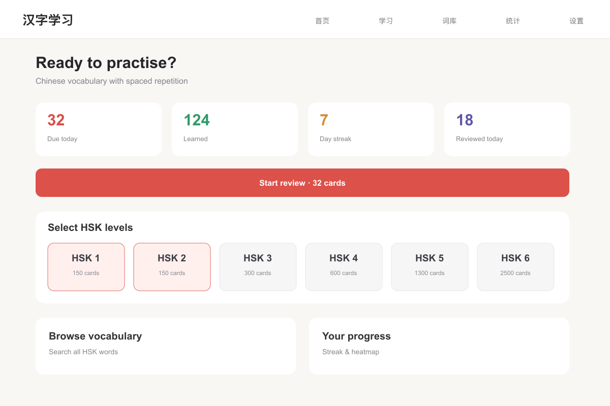
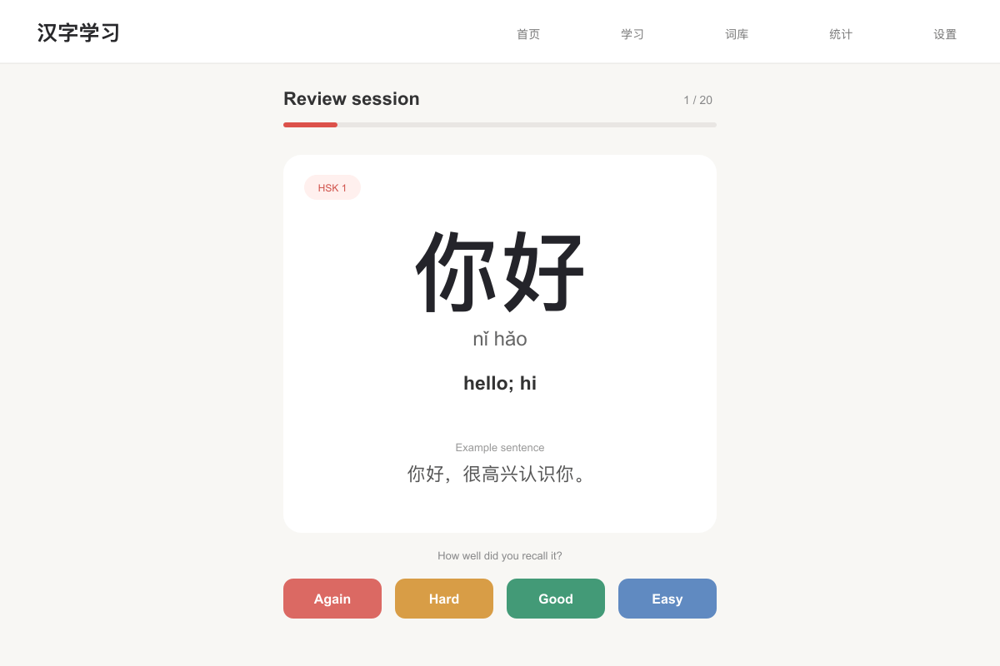

# Portfolio screens

Prepared for the Davin Cuaso portfolio on 6 November 2026.

These are source-based interface recreations with fictional sample data. They are not screenshots from a running native app or backend. Camera scenes and ingredient illustrations are schematic; measurements, saved places, and study statistics are sample content.

The SVG files are editable masters; PNG files are opaque exports.

## Review dashboard

Source: [client/src/pages/HomePage.jsx](https://github.com/davincuaso/chinese-learning/blob/d370f0ab7fa08a3020455f8023f9605fe3dd31b2/client/src/pages/HomePage.jsx), [client/src/components/Layout.jsx](https://github.com/davincuaso/chinese-learning/blob/d370f0ab7fa08a3020455f8023f9605fe3dd31b2/client/src/components/Layout.jsx).

## Vocabulary review

Source: [client/src/components/Card/StudyCard.jsx](https://github.com/davincuaso/chinese-learning/blob/d370f0ab7fa08a3020455f8023f9605fe3dd31b2/client/src/components/Card/StudyCard.jsx), [client/src/pages/StudyPage.jsx](https://github.com/davincuaso/chinese-learning/blob/d370f0ab7fa08a3020455f8023f9605fe3dd31b2/client/src/pages/StudyPage.jsx).

